# Modélisation Complète & Architecture Validée (3NF — 22 Tables)

Cette modélisation normalisée en **3ème Forme Normale (3NF)** de **`creche-manager-api`** intègre les **améliorations architecturales majeures** issues de l'audit indépendant et l'externalisation complète des configurations métier en base :

1. **Fratries sans duplication (`child_guardian` pivot)** : Un parent n'est enregistré qu'une seule fois dans `guardians` et rattaché à tous ses enfants via `child_guardian` avec ses rôles distincts (contact principal, facturation, urgence, retrait).
2. **Encaissements réels & Ventilation comptable (`payments` + `payment_allocations`)** : Découplage strict entre la dette (échéance ou charge) et le règlement financier, autorisant les paiements partiels (acomptes en 2 ou 3 fois) et les règlements groupés.
3. **Moyens de paiement externalisés (`payment_methods`)** : Gestion dynamique et administrable des moyens d'encaissement (Espèces, Flooz, TMoney, Virement, Chèque) avec statut actif/inactif et frais éventuels.
4. **Grille tarifaire dynamique (`pricing_configurations`)** : Tarification souple des prestations annexes (repas 1 500 F/j, garderie du soir 2 000 F/h, forfaits hebdomadaires...) sans valeur en dur dans le code.
5. **Horaires d'ouverture légaux journaliers (`operating_schedules`)** : Définition par jour de la semaine (lundi au dimanche) des plages réglementaires (07h30 - 18h30 Lu-Ve), des minutes de grâce et du calcul automatique des heures supplémentaires de garderie.
6. **Dates et heures précises en `dateTime`** : `attendances` utilise `check_in_at` et `check_out_at` en `dateTime` natif, et `child_events` utilise `event_at` en `dateTime`.
7. **Suppression de `children.section_id` direct** : La section d'un enfant est portée par son inscription annuelle active (`registrations.section_id`), avec une relation Eloquent `hasOneThrough` transparente.
8. **Sécurisation juridique des départs** : Pointage de départ rattaché à `picked_up_by_guardian_id` (clé étrangère vers `guardians`) ou consignation d'un tiers mandaté (`third_party_pickup_name`, `third_party_id_card`).

---

## 1. Diagramme Global des 22 Tables & Relations

```mermaid
flowchart TB
    subgraph AUTH["🔐 AUTHENTICATION-API (SSO Central)"]
        U["Employé Crèche (auth_user)<br/>id, name, email, permissions[]"]
    end

    subgraph REF["📚 RÉFÉRENTIELS & CONFIGURATIONS DYNAMIQUES"]
        SEC["sections<br/>(4 tranches d'âge & capacités)"]
        ST["section_tranches<br/>(4 tranches de scolarité par section)"]
        LANG["languages<br/>(Français, Anglais, Éwé...)"]
        RT["relationship_types<br/>(Père, Mère, Tuteur, Oncle/Tante...)"]
        DT["document_types<br/>(Acte naissance, Carnet vaccins, Certificat...)"]
        CET["child_event_types<br/>(Repas, Sieste, Hygiène, Soins, Fournitures...)"]
        PM["payment_methods<br/>(Espèces, Flooz, TMoney, Virement, Chèque)"]
        PRIC["pricing_configurations<br/>(Tarifs repas, garderie soir, forfaits hebdo)"]
        SCHED["operating_schedules<br/>(07h30-18h30 Lu-Ve, grâce, calcul garderie)"]
    end

    subgraph FAMILY["👶 ENFANTS, FAMILLES & SANTÉ"]
        CH["children<br/>(Identité, sex, habitudes repas/sommeil)"]
        G["guardians<br/>(Parent indépendant, sans child_id direct)"]
        CG["child_guardian<br/>(Pivot Fratrie : primary, billing, emergency, pickup)"]
        CL["child_language<br/>(Pivot N..N langues parlées)"]
        MED["child_medical_profiles<br/>(Vaccins, allergies, médecin, groupe sanguin)"]
    end

    subgraph DOSSIER["📋 INSCRIPTIONS & PIÈCES"]
        REG["registrations<br/>(Dossier annuel, section_id, consentements, statut)"]
        ATT["attachments<br/>(Polymorphique : file_path, document_type_id, verified)"]
    end

    subgraph BILLING["💰 DETTES, ENCAISSEMENTS & ACOMPTES"]
        TI["tuition_installments<br/>(Créance scolarité : amount, paid_amount, status)"]
        AC["additional_charges<br/>(Charges annexes : repas, garderie >18h30, forfaits)"]
        PAY["payments<br/>(Reçu réel : payment_method_id, payer_guardian_id, amount, paid_at)"]
        PA["payment_allocations<br/>(Ventilation comptable dette <-> paiement)"]
    end

    subgraph DAILY["🕒 VIE QUOTIDIENNE & SÉJOUR"]
        ATD["attendances<br/>(check_in_at & check_out_at dateTime, picked_up_by_guardian_id)"]
        EV["child_events<br/>(event_at dateTime, child_event_type_id, timeline)"]
    end

    %% Relations Référentiels
    SEC -->|"1..N"| ST
    SEC -->|"1..N"| REG
    CH -->|"1..N"| CL
    LANG -->|"1..N"| CL
    RT -->|"1..N"| CG
    DT -->|"1..N"| ATT
    CET -->|"1..N"| EV
    PM -->|"1..N"| PAY

    %% Relations Famille (Pivot Fratrie)
    CH -->|"1..N"| CG
    G -->|"1..N"| CG
    CH -->|"1..1"| MED

    %% Relations Inscription
    CH -->|"1..N"| REG
    REG -->|"1..N"| TI
    ST -->|"1..N"| TI

    %% Relations Dettes & Finances
    CH -->|"1..N"| AC
    REG -->|"0..N"| AC
    G -->|"0..N"| PAY
    CH -->|"0..N"| PAY
    PAY -->|"1..N"| PA
    TI -->|"0..N"| PA
    AC -->|"0..N"| PA

    %% Relations Vie quotidienne & Configurations dynamiques
    CH -->|"1..N"| ATD
    G -->|"0..N"| ATD
    CH -->|"1..N"| EV
    SCHED -.->|"Règles horaires"| ATD
    PRIC -.->|"Calcul pénalités/tarifs"| ATD
    PRIC -.->|"Prix unitaires"| AC

    %% Pièces jointes polymorphiques
    CH -.->|"morphMany"| ATT
    REG -.->|"morphMany"| ATT
    EV -.->|"morphMany"| ATT
```

---

## 2. Dictionnaire des 22 Tables Normalisées

| # | Table | Rôle métier | Clés primaires & étrangères principales |
|---|---|---|---|
| 1 | `sections` | Les 4 tranches d'âge officielles de la crèche Petite Lune | `id`, `code` unique |
| 2 | `section_tranches` | Définition des 4 tranches de scolarité pour chaque section | `id`, `section_id` FK |
| 3 | `languages` | Langues parlées au domicile (Français, Éwé, Anglais...) | `id`, `code` unique |
| 4 | `relationship_types` | Liens de parenté normalisés (Père, Mère, Tuteur, Oncle...) | `id`, `code` unique |
| 5 | `document_types` | Typologie des pièces justificatives (Section VII) | `id`, `code` unique |
| 6 | `child_event_types` | Typologie du journal de vie (repas, sieste, change, fournitures) | `id`, `code` unique |
| 7 | `payment_methods` | Modes de paiement acceptés (Espèces, Flooz, TMoney, Virement, Chèque) | `id`, `code` unique |
| 8 | `pricing_configurations` | Grille tarifaire dynamique (repas, garderie du soir, forfaits) | `id`, `code` unique |
| 9 | `operating_schedules` | Horaires officiels d'ouverture/fermeture par jour de la semaine | `id`, `day_of_week` unique (0..6) |
| 10 | `children` | Identité de l'enfant (sans `section_id` direct, avec `sex`) | `id`, `registration_number` unique |
| 11 | `child_language` | Table pivot N..N langues parlées par l'enfant | `child_id`, `language_id` (PK composite) |
| 12 | `guardians` | Entité parent/responsable indépendante (gestion fratries) | `id`, `phone`, `email` |
| 13 | `child_guardian` | Table pivot N..N Fratries et délégations juridiques | `child_id`, `guardian_id`, `relationship_type_id` |
| 14 | `child_medical_profiles` | Fiche de santé (vaccins, médecin, allergies, groupe sanguin) | `id`, `child_id` FK unique (1..1) |
| 15 | `registrations` | Dossier annuel officiel (porte `section_id` actif) | `id`, `child_id` FK, `section_id` FK |
| 16 | `attachments` | Fichiers et justificatifs stockés (`file_path`, polymorphique) | `id`, `document_type_id` FK, `attachable_type`, `attachable_id` |
| 17 | `tuition_installments` | Échéances de dette de scolarité (découplées du paiement) | `id`, `registration_id` FK, `section_tranche_id` FK |
| 18 | `additional_charges` | Charges annexes (repas 1 500 F, garderie post-18h30, forfaits) | `id`, `child_id` FK, `registration_id` FK |
| 19 | `payments` | Reçus d'encaissement réels (montant, date/heure, moyen, reçu) | `id`, `payer_guardian_id` FK, `child_id` FK, `payment_method_id` FK |
| 20 | `payment_allocations` | Table de ventilation comptable (imputation sur échéance/charge) | `id`, `payment_id` FK, `tuition_installment_id` FK, `additional_charge_id` FK |
| 21 | `attendances` | Pointages journaliers d'arrivée/départ (`dateTime` natifs) | `id`, `child_id` FK, `picked_up_by_guardian_id` FK |
| 22 | `child_events` | Cahier de vie / Timeline différée (`dateTime event_at`) | `id`, `child_id` FK, `child_event_type_id` FK |

---

## 3. Schéma Relationnel Détaillé (DML / Colonnes)

### Pôle 1 : Configurations Métier & Référentiels
- **`sections`** : `id`, `code`, `label`, `min_age_months`, `max_age_months`, `registration_fee`, `total_tuition`, `daily_meal_fee`, `hourly_aftercare_fee`, `weekly_rate`, `capacity`, `description`.
- **`section_tranches`** : `id`, `section_id` (FK), `tranche_number`, `code`, `label`, `amount`, `is_due_at_registration`, `due_month`, `due_day`.
- **`languages`** : `id`, `code`, `label`.
- **`relationship_types`** : `id`, `code`, `label`, `description`.
- **`document_types`** : `id`, `code`, `label`, `is_mandatory_for_registration`, `description`.
- **`child_event_types`** : `id`, `code`, `label`, `default_severity`, `icon`, `description`.
- **`payment_methods`** : `id`, `code`, `label`, `is_digital`, `requires_reference`, `is_active`, `description`.
- **`pricing_configurations`** : `id`, `code`, `label`, `unit_price`, `currency`, `billing_period`, `is_active`, `description`.
- **`operating_schedules`** : `id`, `day_of_week` (0=dimanche..6=samedi), `label`, `is_open`, `opening_time`, `closing_time`, `grace_period_minutes`, `overtime_billing_step_minutes`, `notes`.

### Pôle 2 : Familles, Enfants & Santé
- **`children`** : `id`, `registration_number`, `first_name`, `last_name`, `birth_date`, `sex` (`M`/`F`), `birth_place`, `dietary_habits`, `sleep_habits`, `other_useful_info`, `status`, `created_by_user_id`.
- **`guardians`** : `id`, `full_name`, `profession`, `phone`, `phone_secondary`, `email`, `address`.
- **`child_guardian`** : `id`, `child_id` (FK), `guardian_id` (FK), `relationship_type_id` (FK), `is_primary_contact`, `is_billing_contact`, `is_emergency_contact`, `is_authorized_pickup`, `emergency_priority`.
- **`child_language`** : `child_id` (FK), `language_id` (FK).
- **`child_medical_profiles`** : `id`, `child_id` (FK unique), `doctor_name_contact`, `vaccines_up_to_date`, `has_allergies`, `allergies_details`, `medical_conditions`, `has_ongoing_treatment`, `ongoing_treatment_details`, `blood_group`.

### Pôle 3 : Inscriptions & Justificatifs
- **`registrations`** : `id`, `registration_number`, `academic_year`, `child_id` (FK), `section_id` (FK), `status`, `consent_first_aid`, `consent_photos_videos`, `consent_emergency_pickup`, `subscribe_daily_meal`, `subscribe_aftercare`, `subscribe_weekly_package`, `declarant_name`, `signed_at_place`, `signed_date`, `rules_accepted`, `admission_date`, `admin_observations`, `decision_comment`, `decision_datetime`, `created_by_user_id`, `processed_by_user_id`.
- **`attachments`** : `id`, `document_type_id` (FK), `file_path`, `disk`, `mime_type`, `file_size`, `original_name`, `original_filename`, `is_verified`, `description`, `attachable_type`, `attachable_id`, `uploaded_by_user_id`.

### Pôle 4 : Comptabilité, Dettes & Encaissements
- **`tuition_installments`** : `id`, `registration_id` (FK), `section_tranche_id` (FK), `installment_code`, `label`, `amount`, `paid_amount`, `due_date`, `status` (`pending`, `partial`, `paid`, `overdue`), `notes`, `recorded_by_user_id`.
- **`additional_charges`** : `id`, `child_id` (FK), `registration_id` (FK), `charge_type`, `charge_date`, `quantity`, `unit_price`, `total_amount`, `paid_amount`, `status`, `notes`, `recorded_by_user_id`.
- **`payments`** : `id`, `payer_guardian_id` (FK nullable), `child_id` (FK nullable), `payment_method_id` (FK nullable), `payment_method` (code textuel), `receipt_number`, `amount`, `paid_at` (`dateTime`), `payment_reference`, `notes`, `recorded_by_user_id`.
- **`payment_allocations`** : `id`, `payment_id` (FK), `tuition_installment_id` (FK nullable), `additional_charge_id` (FK nullable), `amount`.

### Pôle 5 : Vie Quotidienne & Pointages
- **`attendances`** : `id`, `child_id` (FK), `attendance_date`, `status`, `check_in_at` (`dateTime`), `check_out_at` (`dateTime`), `picked_up_by_guardian_id` (FK), `third_party_pickup_name`, `third_party_id_card`, `dropped_off_by`, `overtime_minutes`, `overtime_hours_billed`, `overtime_amount`, `notes`, `recorded_by_user_id`.
- **`child_events`** : `id`, `child_id` (FK), `child_event_type_id` (FK), `severity`, `title`, `description`, `event_at` (`dateTime`), `metadata` (`JSON`), `is_shared_with_parent`, `supply_fulfilled_at` (`dateTime`), `recorded_by_user_id`.

---

## 4. Statut de Validation

- **Migrations MySQL & SQLite** : 22/22 exécutées avec succès.
- **Suite de tests automatisés (PHPUnit)** : 14 tests passés avec couverture intégrale des fonctionnalités et des 22 entités.
- **Seeders officiels** :
  - `SectionSeeder` (sections, 16 tranches officielles, 5 méthodes de paiement, 6 configurations tarifaires, 7 horaires d'ouverture).
  - `DemoCrecheSeeder` (dossiers complets avec fratries, règlements Flooz/Espèces, pointages avec calcul d'heures sup dynamiques).
- **Intégration SSO authentication-api** : `CrechePermissionSeeder` mis à jour avec `payment_method`, `pricing_configuration`, `operating_schedule`.
